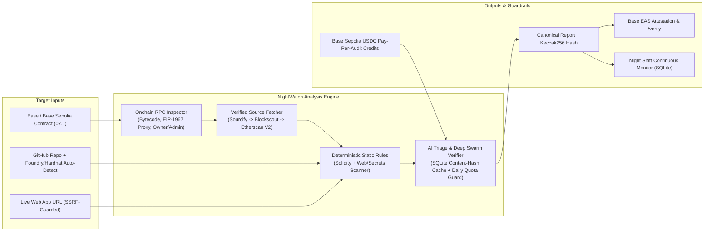

# NightWatch

**NightWatch** is an automated security guard and continuous onchain monitor for **Base** and **Base Sepolia** builders. Paste a **Base contract address (`0x…`)**, a **GitHub repository**, or a **live web app URL** to run a deterministic static + AI-triaged security audit, verify exploitability of leads, hash and attest reports on Base via **EAS**, open one-click fix PRs, or start **Night Shift** watch mode.

## Architecture



## Honest Limitations

- **Static & AI-reasoned analysis only (not a formal audit):** Contract checks combine onchain RPC reads, verified source from Sourcify/Blockscout/Etherscan V2, deterministic regex/AST-lite static rules (`lib/rules.ts`), and grounded LLM review (`lib/ai.ts`). There is no symbolic execution or stateful fuzzing, and absence of findings does not guarantee safety.
- **Exploit scenarios are reasoned from the code, not executed:** Deep Swarm adversarial verification reasons through caller permissions, state transitions, Solidity 0.8 overflow checks, and net attacker gain (`attacker`, `gain`, `victim`), but it does **not** execute transactions on an Anvil fork or live network. Every UI view and exported report states: *"Exploit scenarios are reasoned from the code, not executed."*
- **Base Sepolia testnet USDC payments only:** Priority queue and Deep Swarm tiers accept Circle's Base Sepolia testnet USDC (`0x036CbD53842c5426634e7929541eC2318f3dCF7e`) via direct transfer receipt verification, not mainnet USDC or an escrow stake-and-slash contract.
- **Free-tier AI quota & rate limits:** A global daily AI request budget (`NIGHTWATCH_AI_DAILY_BUDGET`, default `15` calls/day) is tracked in SQLite (`ai_daily_usage`) and paired with content-hash caching (`ai_cache`). When the daily quota is reached, AI stages are skipped and reports explicitly state: `"Daily AI quota reached: static checks only, findings unconfirmed"` — NightWatch never fabricates findings. Deep Swarm checks the remaining budget upfront and refuses + refunds the payment credit before starting if there is not enough budget for the full specialist lens set + verifier.

## What it actually does

| Input | What is analyzed |
|---|---|
| `0x…` Base contract | RPC reads on Base mainnet (code size, EIP-1967 proxy slots, admin/owner and whether they're EOAs, `initialized()`, opcode scan for SELFDESTRUCT). Verified source is pulled from Sourcify → Blockscout → Etherscan V2 (if key set); proxies are followed to the implementation. |
| GitHub repo | Solidity + app source via GitHub API. Any hard-coded addresses are checked on Base and their verified source is added. |
| Live URL | Response headers (CSP, HSTS, framing), third-party scripts without SRI, leaked secrets in JS bundles, source maps, and address constants in the bundle, which are then inspected onchain. |

Then:
1. **Static rules** (`lib/rules.ts`) produce line-referenced *leads* (tx.origin auth, unchecked calls/transfers, reentrancy ordering, unguarded initializers, spot-price oracles, arbitrary `from`, …).
2. **AI triage** (`lib/ai.ts`, powered by `lib/llm.ts`) confirms or dismisses every lead against the surrounding code and adds new findings. Supports Anthropic Claude, Google Gemini, and Alibaba Qwen. Every AI finding must cite a real file + line and quote code that exists there, or it is discarded.
3. The report is canonicalized and hashed (keccak256). You can **attest** it on Base with EAS and anyone can **verify** it at `/verify`.

If an AI API key (`ANTHROPIC_API_KEY`, `GEMINI_API_KEY`, or `DASHSCOPE_API_KEY`) is missing or the AI call fails, the report says so and static leads stay marked unconfirmed. It never fills the gap with made-up results.

## Run it

```bash
cp .env.example .env.local   # pick NIGHTWATCH_PROVIDER and add its API key
npm install
npm run dev
```

Try the pipeline without the UI: `npm run audit:cli -- 0x833589fCD6eDb6E08f4c7C32D4f71b54bdA02913`

### Enable onchain attestations (one time)

```bash
DEPLOYER_PRIVATE_KEY=0x… npm run register-schema   # funded Base account
# put the printed UID in .env.local as NEXT_PUBLIC_EAS_SCHEMA_UID
```

EAS on Base: `EAS 0x4200000000000000000000000000000000000021`, `SchemaRegistry 0x4200000000000000000000000000000000000020`.
The attestation stores report hash, target, severity counts, timestamp and whether AI reviewed it. It proves what was scanned and found, **not** that a project is safe.

## Deploy

NightWatch requires a **long-running Node host (Node >= 22.13)** with a persistent filesystem volume (Railway, Fly.io, or dedicated VPS). It is **not suitable for serverless** (e.g. Vercel Serverless Functions) because:
1. Audits stream progress events for several minutes (`/api/audit` has `maxDuration = 300`).
2. Deep swarm jobs and Night Shift watchers run statefully in-process with `node:sqlite`.
3. An in-process worker (`NIGHTWATCH_WORKER=1`) ticks scheduled watch evaluations every 60 seconds.

### Docker Build & Run

Client-side environment variables (`NEXT_PUBLIC_*`) are inlined at build time and must be passed as build arguments.

```bash
# 1. Build the image
docker build \
  --build-arg NEXT_PUBLIC_EAS_SCHEMA_UID="0x0c57cb369bf451ea40118e367beb29e6f23c8e0913b29058287337a86237e5c3" \
  -t nightwatch .

# 2. Create persistent volume for SQLite database
docker volume create nightwatch_data

# 3. Run container with persistent volume
docker run -d \
  --name nightwatch \
  -p 3000:3000 \
  -v nightwatch_data:/data \
  --env-file .env.production \
  --restart unless-stopped \
  nightwatch
```

Check health inside or outside the container:
```bash
curl http://localhost:3000/api/health
# Response: {"ok":true,"node":"v22.14.0","worker":true,"db":"ok","ai":true,"payments":true}
```

### Fly.io Deployment

Fly.io configuration requires a **single machine** and persistent volume so the SQLite database is not split or corrupted across instances.

Key settings in `fly.toml`:
- `auto_stop_machines = false` (prevents killing the in-process watch worker)
- `auto_start_machines = true`
- `min_machines_running = 1` (keeps exactly 1 machine running)
- `[mounts] source = "nightwatch_data" destination = "/data"`
- Health check path = `/api/health`

Deploy steps:
```bash
# Create volume in the primary region
fly volumes create nightwatch_data --size 1 --region iad

# Set secrets
fly secrets set \
  SESSION_SECRET="$(openssl rand -hex 32)" \
  CRON_SECRET="$(openssl rand -hex 32)" \
  GEMINI_API_KEY="..." \
  GITHUB_TOKEN="..." \
  GITHUB_OAUTH_CLIENT_ID="..." \
  GITHUB_OAUTH_CLIENT_SECRET="..." \
  NIGHTWATCH_TREASURY="0x..."

# Deploy with build args
fly deploy --build-arg NEXT_PUBLIC_EAS_SCHEMA_UID="0x0c57cb369bf451ea40118e367beb29e6f23c8e0913b29058287337a86237e5c3"
```

### Railway Deployment

1. Create a new Railway project from GitHub repo.
2. In **Settings -> Build**, pass build argument:
   `NEXT_PUBLIC_EAS_SCHEMA_UID=0x0c57cb369bf451ea40118e367beb29e6f23c8e0913b29058287337a86237e5c3`
3. Add a **Persistent Volume** mounted at `/data`.
4. Set environment variables:
   - `NIGHTWATCH_DB_PATH=/data/nightwatch.db`
   - `NIGHTWATCH_WORKER=1`
   - `SESSION_SECRET=<random-32-chars>`
   - `CRON_SECRET=<random-32-chars>`
   - `BASE_RPC_URL=https://mainnet.base.org`
   - `BASE_SEPOLIA_RPC_URL=https://sepolia.base.org`
   - `NIGHTWATCH_TREASURY=0x...`
   - `NIGHTWATCH_PRICE_PRIORITY_USDC=1` (or 0.1 for demo)
   - `NIGHTWATCH_PRICE_DEEP_USDC=5` (or 0.5 for demo)
5. Set Healthcheck path to `/api/health`.


## Safety notes

- Server-side fetches of user URLs are SSRF-guarded (private/loopback/link-local/metadata ranges refused, redirects re-checked).
- Live-URL mode is read-only: it fetches what a browser would. It never logs in, submits forms, or sends attack traffic.
- Automated analysis is not a formal audit.

## Night Shift (watch mode)

"Going to sleep" takes the current scan as a baseline, then re-checks every 30 min – 3 h for up to 48 h:

- **Cheap checks every interval:** latest commit SHA, deployed script bundle set, live URL up/down, and Base state for every contract found (runtime code hash, EIP-1967 implementation, admin, `owner()`).
- **Full re-scan only when something changed**, then a diff of findings against the previous scan (new vs. resolved).
- The **Morning Briefing** (`/watch/<id>?k=<key>`) is the recorded incident log. "Replay the night" steps through those real events. The link's key is the only credential, so keep it private.

Needs a long-running Node host (SQLite via `node:sqlite`, Node >= 22.13). Set `NIGHTWATCH_WORKER=1` to run the in-process worker, or call `POST /api/watch/tick` from a cron with `CRON_SECRET`.

## One-click fix PRs

For GitHub targets, findings with a patch get **Open fix PR**. Flow: GitHub OAuth (`public_repo` scope), re-read the current file, apply the diff only if every context line matches (stale or ambiguous patches are refused), create `nightwatch/<slug>-<id>`, commit, open a PR. Requires push access. The patch is not compiled or tested; the PR says so.

## Judge Sandbox

Four intentionally vulnerable samples (`lib/samples.ts`) run through the same pipeline as any submission. Nothing is canned.

## One-click project flow

Connect GitHub (optionally with private-repo access) and a Base wallet, pick a repo, and NightWatch fills in the rest (`lib/detect.ts`):

- **Contracts:** Foundry `broadcast/*/{8453,84532}/run-latest.json`, Hardhat Ignition `deployed_addresses.json`, `hardhat-deploy` files, `deployments.json`-style files, `.env.example` address variables, and README mentions. Every address is then checked onchain: only real contracts on Base or Base Sepolia are kept (deployment-file hits are kept even if the RPC is unreachable, marked "not confirmed").
- **Live URL:** the repo's homepage field, `package.json` homepage, and Vercel/Netlify/Render/etc. links in the README. Editable before you start.
- **"Start Night Shift Guard"** runs one scan over repo + URL + contracts, then (if you leave it on) starts Night Shift with that scan as the baseline.
- You can also paste any public `owner/name` without signing in.
- **Private Repository Privacy:** Source code from private repositories is sent to the configured AI provider (Google Gemini, Anthropic, or Qwen) strictly for vulnerability analysis. Reports for private repositories are never permanently stored in the server SQLite database. Watching private repos is disabled (to avoid storing GitHub credentials).
- **Free-Tier Protection (`NIGHTWATCH_ALLOW_PRIVATE`):** By default, scans of private repositories are blocked when running on free-tier or unverified provider keys. To permit private code to be sent to your configured AI provider, set `NIGHTWATCH_ALLOW_PRIVATE=true` in `.env.local`.

Contract checks are static: verified source from Sourcify, Blockscout or Etherscan V2, onchain reads, rule-based analysis and AI review. There is no symbolic execution and no fuzzing, and live URLs are only read, never attacked.

## Pay-per-audit (testnet USDC on Base Sepolia)

| Tier | Price (env) | What you get |
|---|---|---|
| Standard | free | the normal pipeline |
| Priority | `NIGHTWATCH_PRICE_PRIORITY_USDC` (1) | skips ahead of free scans waiting in the queue |
| Deep swarm | `NIGHTWATCH_PRICE_DEEP_USDC` (5) | 3-5 specialist AI reviewers (access control, reentrancy/fund flows, oracle/economic, upgrades/signatures, frontend/agent surface) plus an adversarial verifier that tries to build an exploit for each serious finding. Runs in the background; open the link later. |

How a payment works: the order gets a unique amount (price + 1-9999 micro-USDC) → the user sends exactly that to `NIGHTWATCH_TREASURY` → the server reads the receipt on Base Sepolia and checks the USDC `Transfer` log (right token, right recipient, exact amount, inside the order's 30-minute window, tx hash never used before) → the order becomes a single-use credit → it is spent atomically when the run starts, and **returned if the run fails before producing a report** (including server restarts mid-job). The server never holds a key.

- This is a **payment, not a refundable stake**. Stake-and-slash would need an escrow contract.
- **Priority** is a head start (`NIGHTWATCH_PRIORITY_HEAD_START_SEC`, default 600) in a real queue (`NIGHTWATCH_CONCURRENCY` audits at once, default 2). When nothing is waiting it changes nothing, and the UI says so. Free scans older than the head start still go first, so nobody starves.
- Deep-swarm attack scenarios are reasoned from the code, **not executed**; the report says so. The deep tier needs an AI API key (`ANTHROPIC_API_KEY`, `GEMINI_API_KEY`, or `DASHSCOPE_API_KEY`) and is disabled without it.
- USDC on Base Sepolia is Circle's `0x036CbD53842c5426634e7929541eC2318f3dCF7e`. Get test USDC at faucet.circle.com (and a little Base Sepolia ETH for gas).
- Deep jobs run in-process (like Night Shift), so they need a long-running Node host.

Tests: `npx tsx scripts/paytest.ts` (payments, queue, merge, grounding, detection parsers, project targets: all offline with mocked chain data).

## Not built yet

- Foundry fork-test exploit reproduction (deep-swarm exploits are not executed yet).
- Tranche Proof-of-Ship (needs Vibestarter's real tranche rules).
- Mainnet USDC payments (one constant in `lib/pricing.ts` plus a real escrow decision).
